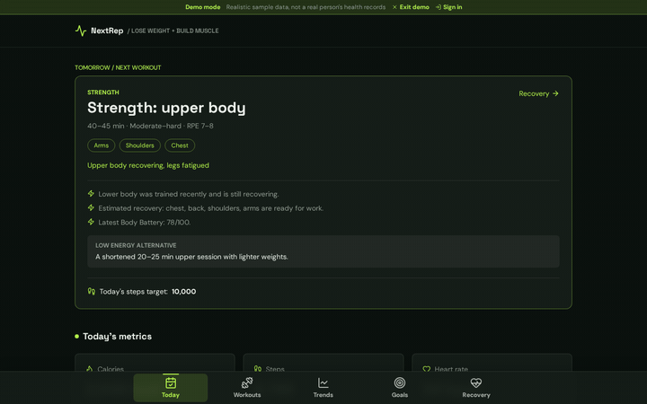
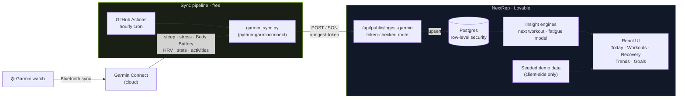

<div align="center">

# NextRep

**Your Garmin data, turned into one clear answer: what should I train next?**

Lose weight, build muscle: one clear next rep at a time.

[**▶ Try the live demo**](https://myrecoverypal.lovable.app/demo) 



</div>

---

## Why I built this

My Garmin watch collects great data (heart rate, Body Battery, stress, sleep, every workout), but the Garmin Connect app only shows it back to me. It never answers the question I actually have each morning: *given my goal, how recovered am I, and what should I do today?*

The obvious fix was to pull the data into my own app. Then I hit the real problem: **Garmin paused new access to its developer API in 2026**, and third-party aggregators that still have access cost hundreds of dollars a month. So I built my own pipeline.

## What it does

| | |
|---|---|
| 🎯 **Next-workout engine** | Recommends tomorrow's session (strength, Zone 2 cardio or recovery), with the duration, heart-rate range and the reasons behind it, based on training history, Body Battery, stress, sleep and weekly targets. |
| 💪 **Automatic muscle recovery map** | Estimates fatigue for 9 muscle groups from Garmin's exercise data, with no manual logging. Fatigue decays over 36–48h and adjusts to Body Battery. |
| 📊 **Workout deep-dives** | Every session gets time in each heart-rate zone, splits, a comparison with the previous session of the same type, and a "what this did for your goal" note. |
| 🔋 **Daily vitals** | Calories, steps, heart rate, Body Battery and stress, each with a 7-day trend. |
| 📈 **Goal tracking** | Weight trend toward target, weekly strength and cardio targets, a streak counter, and a plain-English insights feed comparing this week with last week. |
| 👀 **Public demo mode** | 90 days of realistic seeded sample data, generated in the browser so no real health data is exposed. |

## Architecture



**Data flow:** watch → Garmin Connect → an hourly GitHub Actions job pulls the last 2 days (or any backfill window) → posts to a token-protected route → upserted into Postgres → the UI computes recommendations on read.

## Engineering decisions

**1. Working around a closed API.**
Garmin's official Health API stopped accepting new developers, and paid aggregators were too expensive for a personal project. I used the open-source `python-garminconnect` library (v0.3+, which reads the same data the Garmin mobile app does) and run it on a **free GitHub Actions schedule** instead of paying for a server. Login tokens are created once locally and stored as an encrypted Actions secret.

**2. Securing a public endpoint.**
The ingest route has to be reachable from GitHub's servers, so it's public, but it rejects any request without a shared secret token. The Garmin tables are locked by **row-level security** to a single account, and every other table is scoped to its own user. Demo mode never touches the database at all.

**3. Messy real-world data.**
Wearable data is full of traps, and each one is handled explicitly:
- Garmin reports stress as `-1`/`-2` when it lacks data, so those are treated as missing, not zero.
- Resting heart rate is only trusted on days with recorded sleep; otherwise it's just the lowest daytime reading.
- Most strength sessions record their exercises as `UNKNOWN`, so the fatigue model falls back to a full-body estimate and labels it as one.
- The complete raw Garmin payload is stored in a `jsonb` column, so new metrics can be added later without re-syncing.

**4. The fatigue model.**
Each Garmin exercise category (e.g. `SQUAT`, `BENCH_PRESS`, `PUSH_UP`) maps to primary (100%) and secondary (50%) muscle groups. Load is sets × reps, and cardio adds leg load weighted by time in heart-rate zones 3–5. Fatigue decays exponentially, faster for small muscle groups, and slows by 25% when Body Battery is under 40.

**5. Recommendations people can trust.**
The next-workout engine is **rule-based, not a black box**. Every recommendation shows the exact numbers that drove it, such as "Strength was yesterday · Body Battery 58 · 7 cardio minutes this week vs a 150-minute target", plus a lower-energy alternative.

## Tech stack

| Layer | Tools |
|---|---|
| Data sync | Python 3.12, `python-garminconnect`, `requests` |
| Scheduling | GitHub Actions (cron, manual backfill trigger) |
| App | TypeScript, React, Tailwind CSS, shadcn/ui, built with [Lovable](https://lovable.dev) |
| Backend | Lovable Cloud (Postgres, auth, row-level security, server routes) |
| AI tooling | Lovable's agent for UI and app code; Claude for research, pipeline code and data verification |

## Run it yourself

<details>
<summary><b>1. Set up the sync</b></summary>

```bash
python3 -m venv .venv && source .venv/bin/activate
pip install "garminconnect>=0.3" requests
python garmin_sync.py --login          # one-time; saves ~/.garminconnect/garmin_tokens.json
```

Test a backfill:

```bash
export INGEST_URL="https://<your-app>/api/public/ingest-garmin"
export INGEST_TOKEN="<random secret, e.g. openssl rand -hex 32>"
python garmin_sync.py --days 30
```
</details>

<details>
<summary><b>2. Automate with GitHub Actions</b></summary>

Add `.github/workflows/garmin-sync.yml` (included) and three repository secrets:

| Secret | Value |
|---|---|
| `GARMIN_TOKENS` | contents of `~/.garminconnect/garmin_tokens.json` |
| `INGEST_URL` | your app's `/api/public/ingest-garmin` URL |
| `INGEST_TOKEN` | the same secret stored in the app's backend |

It runs hourly. Use **Actions → Garmin sync → Run workflow** with a `days` value to backfill history.
</details>

## Roadmap

- [ ] Sleep- and HRV-based readiness score (now that the watch is worn overnight)
- [ ] Multi-user support, so each person can connect their own Garmin
- [ ] AI coach: plain-English weekly review and plan
- [ ] Nutrition input to track the calorie balance for weight loss

## Notes

- Built for **personal use**. `python-garminconnect` is an unofficial library and isn't affiliated with or endorsed by Garmin. Garmin may change its login flow at any time.
- No real health data is included in this repository or shown in the demo.

---

<div align="center">

Built by **Sharyu Deshmukh** · [LinkedIn](https://www.linkedin.com/in/sharyu02deshmukh/)

</div>
